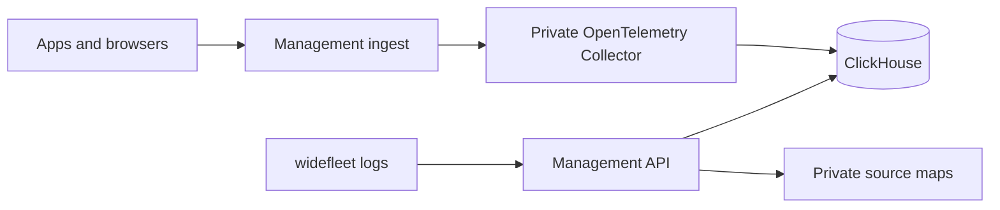

Runtime logs collect app errors and console output in ClickHouse inside your
infrastructure. The starter reports browser and server errors automatically, and
app authors and coding agents query them with `widefleet logs`, including
original source locations from private source maps. The local `./dev`
installation starts runtime logs automatically.



## Enable runtime logs

1. Add `infra/compose.telemetry.yaml` to the explicit `COMPOSE_FILE` list and set
   two different random passwords. With local PostgreSQL and RustFS:

   ```dotenv
   COMPOSE_FILE=infra/compose.base.yaml:infra/compose.postgres.yaml:infra/compose.s3.yaml:infra/compose.rustfs.yaml:infra/compose.telemetry.yaml
   CLICKHOUSE_READ_PASSWORD=REPLACE_WITH_RANDOM_HEX
   CLICKHOUSE_INGEST_PASSWORD=REPLACE_WITH_DIFFERENT_RANDOM_HEX
   ```

   For other selections, append the file as in
   [external services](/self-hosting/external-services#select-the-installation).

2. Create `${PLATFORM_DATA_DIRECTORY}/clickhouse` and
   `${PLATFORM_DATA_DIRECTORY}/otel-queue`, and give the Collector's container user
   (UID and GID `10001`) ownership of `otel-queue`. ClickHouse prepares its own
   directory.

   ```sh
   mkdir -p /srv/app-platform/clickhouse /srv/app-platform/otel-queue
   docker run --rm --user 0 \
     -v /srv/app-platform/otel-queue:/data \
     debian:bookworm-slim@sha256:3783cc01769c7b2b1b83a5c5ad96c815348e28ed7da68e2e3687004faa906251 \
     chown 10001:10001 /data
   ```

3. Pull and start ClickHouse and the Collector. Compose recreates management with
   the telemetry settings:

   ```sh
   docker compose --env-file widefleet-images-0.7.6.env --env-file /absolute/path/deployment.env pull clickhouse otel-collector
   docker compose --env-file widefleet-images-0.7.6.env --env-file /absolute/path/deployment.env up -d clickhouse otel-collector control-plane
   ```

4. Redeploy each app. The next deployment turns on log capture for that app.
   Existing apps based on an older starter first need the starter's current hooks
   and Vite source maps.

## Verify

From an app project, open the redeployed app in a browser, then run:

```sh
widefleet logs --since 15m
```

The output includes the starter's request records, such as `GET /: 200`. If the
command reports that runtime logging is not configured, check that management was
recreated with the telemetry file selected.

## Operate runtime logs

- ClickHouse and the Collector publish no ports. Only management joins their
  private network; apps send logs to management over HTTPS.
- Keep the `clickhouse` and `otel-queue` directories across updates and include
  them in [backups](/self-hosting/operations#back-up-and-restore).
- `infra/telemetry/schema.sql` initializes a new ClickHouse directory. Apply
  versioned schema updates to an existing directory explicitly.
- Records are kept for 30 days after ingestion. Changing retention is a versioned
  schema change. Deleting an app ends its log access and ingestion immediately;
  stored records expire with the retention period.
- Published apps keep sending logs while the agent is stopped or disabled.
  Rotating `BETTER_AUTH_SECRET` rotates the apps' ingestion credentials; redeploy
  existing apps afterwards.
- Logs contain application-controlled messages and stack traces, which can
  include app data. Management reads them with a read-only ClickHouse account,
  and CLI users never receive ClickHouse credentials or SQL access.

Telemetry runs independently of app requests, so apps keep serving while logging
is unavailable. The Collector buffers up to 10,000 requests per signal on disk
and retries while ClickHouse is unavailable. Apps and browsers send each record
once, so records sent during a management outage or runtime crash, or while the
Collector's queue is full, are not stored. Monitor disk space, Collector export errors and delivery errors in the
runtime log. Retries can occasionally store a record twice.

## What is captured

Widefleet captures console records and exceptions from HTTP requests. Each app
writes only to its own logs. Cron, Queue and service (RPC) executions do not
appear in app logs, and distributed traces are not exported; use the
[container logs](/self-hosting/operations#logs-and-troubleshooting) for those.

The starter also reports unexpected SvelteKit errors, server HTTP 5xx responses,
browser `error` and `unhandledrejection` events, and explicit `captureError`
calls. Report deliberately caught failures with `captureError`. Browser reports
require app sign-in, are rate-limited and keep the build ID of the running tab.
Server records carry the deployment ID; filtering by deployment also includes
browser errors from that deployment's build.

Source maps stay in private artifact storage. Stack frames show the generated
location and, when a matching map exists, the original file, function, line and
column. Without a valid map, the generated stack remains available. Each query
loads up to 32 MiB of maps and resolves up to 64 stack lines per record.

## Querying

```sh
widefleet logs --level error --since 1h --json
widefleet logs --source browser --json
widefleet logs --deployment DEPLOYMENT_UUID --json
widefleet logs --request-id REQUEST_ID --json
widefleet logs --trace-id TRACE_ID --json
widefleet logs --query "connection refused" --since 30m --json
widefleet logs --follow --json
```

By default, the command returns the latest 100 records from the last hour.
`--limit` accepts 1–500. `--since` accepts a duration (`s`, `m`, `h`, `d`) or an
ISO timestamp, and `--until` ends a historical range; ranges cover up to 30 days.
`--level` sets a minimum severity. Sources are `browser`, `server` and `runtime`.
Without an app argument, the CLI uses `name` from the project's Wrangler
configuration. Redirected output is JSON lines; diagnostics go to stderr.

`--follow` prints recent history, then streams newly received records until
Ctrl-C. For a complete range, query with `--since` and `--until`.

Queries use current app permissions: the app's owner, its collaborators and
administrators. Ordinary app users get no log access. If logging is not set up,
queries return `503` with `TELEMETRY_NOT_CONFIGURED`; if it is temporarily
unavailable, they return `TELEMETRY_UNAVAILABLE`, and details appear in the
management log. The API is `GET /api/v1/apps/{appId}/logs` with the same filters
and `platform:read`; see the OpenAPI description for the full contract.
